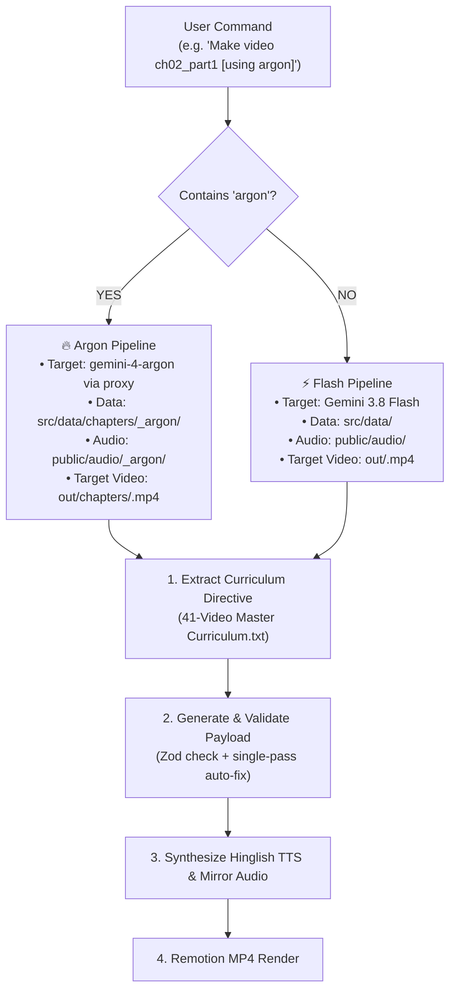
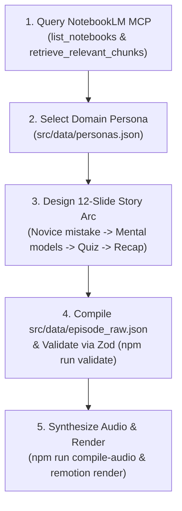

# AGENTS.md — Autonomous NotebookLM-to-Video Engine Protocol

This document serves as the permanent system instructions for the Antigravity Agent. Whenever the user requests the generation of an educational video from a book chapter, topic, or NotebookLM notebook, execute the following autonomous workflow end-to-end.

---

## Direct Curriculum Command Dispatcher: Argon vs. Flash Routing

Whenever the user issues a command to generate or make a video directly (e.g. `"Generate Chapter 2 Part 1 using Argon"`, `"Make video ch02_part1 using argon"`, or `"Make video ch02_part1"`), inspect the prompt for the word **"argon"** (case-insensitive):



### Route A: IF "argon" IS PRESENT (Full Automated Argon Pipeline)
When triggered (e.g. `"Generate Chapter 2 Part 1 using Argon"` or `npm run make-video -- ch02_part1 argon`):
1. **Curriculum Extraction**:
   - Read `41-Video Master Curriculum.txt` in the root directory.
   - Locate the exact STEP 4 command string matching the requested chapter/part (e.g. `ch02_part1.mp4`).
2. **Isolated Workspace Initialization**:
   - Create brand-new isolated directories:
     - Data: `src/data/chapters/<chapter_key>_argon/`
     - Audio: `public/audio/<chapter_key>_argon/` (mirrored in `src/data/chapters/<chapter_key>_argon/audio/`)
     - Final Render Target: `out/chapters/<chapter_key>.mp4`
   - **Strict Isolation**: Never modify or overwrite base production files (`src/data/episode_raw.json` or `src/data/episode_compiled.json`).
3. **Argon Generation via Proxy (`free-gemini-api`)**:
   - Route script generation request through **Gemini 4 Argon** (`gemini-4-argon`) utilizing the local `free-gemini-api` proxy setup (`https://github.com/kodelyx/free-gemini-api.git`) at `http://127.0.0.1:8001/v1/chat/completions`.
   - The proxy connects directly to the user's authenticated web session on `gemini.google.com` via the companion Chrome extension (`free-gemini-api/gemini-extension`), allowing genuine Gemini 4 Argon generation without paid Google AI Studio API keys.
   - Enforce strict JSON schema compliance (`src/data/schema_reference.json`) with low temperature (`0.2`), valid visual template typing, zero Devanagari in UI states, and correct phonetic mapping (`नतीजे` instead of `रिज़ल्ट`).
4. **Single-Pass Automated Self-Correction Loop**:
   - Run `node scripts/validate_episode.mjs --dir=src/data/chapters/<chapter_key>_argon`.
   - If any Zod validation error or visual coordinate collision is detected, automatically apply code remedies (phonetic sanitizer, required fields, margin bounds) and re-validate **strictly once** to prevent infinite loops.
5. **Compile & Render**:
   - Compile Hinglish TTS audio into the isolated directory: `node scripts/compile_tts_audio.mjs --dir=src/data/chapters/<chapter_key>_argon --force`.
   - Render the final MP4 video using Remotion: `npx remotion render src/index.ts EpisodeComposition out/chapters/<chapter_key>.mp4 --props=src/data/chapters/<chapter_key>_argon/episode_compiled.json`.

### Route B: OTHERWISE (Standard Gemini 3.8 Flash Pipeline)
When triggered without the word "argon" (e.g. `"Make video ch02_part1"` or `npm run make-video -- ch02_part1`):
1. Locate curriculum entry in `41-Video Master Curriculum.txt`.
2. Target standard production workspace:
   - Data: `src/data/episode_raw.json` & `src/data/episode_compiled.json`
   - Audio: `public/audio/`
   - Target Video: `out/<chapter_key>.mp4`
3. Generate with default Gemini Flash model configuration.
4. Validate, compile audio, and render to `out/<chapter_key>.mp4`.

---

## Autonomous 5-Step Protocol



---

### Step 1: Query Gemini Notebook (NotebookLM) & Build Source-Grounded Lesson Architecture
1. The **Gemini Notebook (`nlm`) is the STRICT SINGLE SOURCE OF TRUTH** for all educational content.
2. **Never search the web or chat** for book concepts, examples, formulas, or numbers.
3. If no matching notebook exists for the requested book or topic, **HALT IMMEDIATELY AND ASK THE USER FIRST**. Do not improvise or use web search.
4. Execute `nlm notebook list` to identify the notebook matching the requested book (e.g. `Fundamentals of Futures and Options Markets` or `Murphy technical analysis`).
5. Query the book source via `nlm query notebook <notebook_id> "<curriculum_directive>" -s <source_id> --new-conversation --json`.
6. **Phase 1 Source-Grounded Lesson Architecture (All Chapters — Existing and Future, No Legacy Exemptions)**:
   Inside every `src/data/chapters/<chapter_slug>/` workspace, the engine strictly requires and maintains 4 source artifacts:
   - **`source_facts.json`**: Structured facts conforming to `SourceFactsSchema` preserving notebook ID, source ID, retrieval timestamp, claims, definitions, formulas (with variables, symbols, units), numerical details, and book citations. Replaces unstructured text. Never fabricate citations or numbers.
   - **`content_audit.json`**: Audit report conforming to `ContentAuditSchema` evaluating:
     * Source coverage & missing definitions
     * Prerequisites
     * Numerical examples (strikes, spot, premiums, leverage, quantities)
     * Formula variables, units, signs (+/- long/short, debit/credit)
     * Contract sizes & market multipliers
     * Underlying market assumptions
     * Payoff vs Profit distinction (ensuring payoff $\max(S-K,0)$ is never conflated with profit $\text{Payoff} - \text{Premium}$)
     * Zero generic boilerplate
     * Status: `PASS`, `CONDITIONAL_PASS`, or `FAIL`. **Unresolved CRITICAL findings trigger FAIL and block both episode generation and Remotion rendering immediately.**
   - **`lesson_plan.json`**: Core pedagogical flow, prerequisites, learning outcomes, grounded fact IDs, misconceptions with author rebuttals, and active recall quiz scenario.
   - **`storyboard.json`**: 12-scene sequence where every scene and beat outline explicitly references approved `sourceFactIds`.
7. **Anti-Generic Boilerplate Invariant**:
   The generator must NEVER replace missing chapter-specific content with generic finance or technical-analysis recap text. Report gaps and request repair instead.

---

### Step 2: Select Domain Persona (`src/data/personas.json`)
Identify the domain of the book and load the corresponding persona configuration:

| Domain | Novice Persona | Mentor Persona | Context / Analogy Environment | Presets Available |
| :--- | :--- | :--- | :--- | :--- |
| **Finance / Trading** | **Raju** (Retail Trader, Amber) | **Sharma ji** (Chartist Mentor, Teal) | Indian NSE Market, Nifty, fictional Indian stocks in ₹ (e.g. Kesar Paints) | `uptrend_then_drop`, `uptrend_break`, `bull_breakout`, `head_and_shoulders`, `random_walk_line` |
| **Coding / Systems** | **Aarav** (Junior Dev, Amber) | **Vikram** (Staff Architect, Blue) | High-traffic Indian fintech/e-commerce outage, latency spikes, DB bottlenecks | `latency_spike`, `throughput_scaling`, `memory_leak_curve`, `load_balancer_flow` |
| **Psychology / Habits** | **Kabir** (Young Pro, Amber) | **Dr. Meera** (Psychologist, Purple) | Everyday workplace stress, career choices, habits, cognitive biases | `habit_compounding`, `dopamine_spike_drop`, `decision_fatigue_curve`, `expectation_vs_reality` |

Always preserve the domain's `keepEnglishTerms` phonetically in Devanagari or English (e.g. `margin`, `latency`, `bias`) and format numbers as digits (`₹152`, `200ms`, `30%`).

---

### Phase 2A Generic, Data-Driven Visual Engine & Template Registry

The video engine operates on a **generic, data-driven visual contract** decoupled from finance-specific assumptions:

1. **Course Configuration (`src/courses/<course_id>.json`)**:
   Defines the course ID, book title, subject/domain, allowed templates, allowed units & formatters, visual theme, and persona. Adding a new book requires **zero TypeScript renderer code edits**.

2. **Structured Visual Specifications (`visual`)**:
   Chart values, formulas, and diagrams are supplied via typed `visual` specifications on each beat—never derived by regex-scraping narration or subtitles for `₹` or numbers:
   ```ts
   visual: {
     kind: 'chart' | 'formula' | 'diagram' | 'comparison' | 'timeline' | 'process' | 'cards' | 'conversation' | 'quiz' | 'summary',
     data: ChartSpec | FormulaSpec | DiagramSpec | unknown,
     semantics: {
       teachingObjective: string,
       sourceFactIds: string[],
       importantValues?: string[],
       relationships?: string[]
     }
   }
   ```

3. **Visual Template Registry (`src/templates/registry/templateRegistry.ts`)**:
   Defines available templates, accepted data schemas, valid animation targets, required data types, and fallbacks. The generator chooses only templates whitelisted by the selected course configuration.

4. **Generic Formula Engine (`FormulaBreakdown.tsx`)**:
   Accepts structured expressions, variables with symbols/units/values, and step-by-step substitution cards. Supports physics ($F = m \cdot a$), arithmetic, business metrics, and finance.

5. **Generic Diagram & Timeline Engine (`DiagramFlow.tsx`)**:
   Renders node-edge graphs, chronological timelines (BCE/CE milestones), biological cycles, and software architectures with animated transitions.

6. **Isolated Finance Domain Module (`src/domain/finance/`)**:
   Candlestick presets, rupee currency formatting, payoff diagrams, and financial directional validation are isolated in `src/domain/finance/` as an optional extension. The common renderer operates with zero currency or finance coupling when that module is absent.

7. **Universal Backward Compatibility (`src/adapters/legacyVisualAdapter.ts`)**:
   All pre-existing chapter episodes continue to render cleanly via the adapter without data mutation.

---

### Step 3: Design the 12-Slide Pedagogical Story Arc
Every generated video must strictly follow this 12-slide pedagogical rhythm:

1. **Slide 1 — Hook Part 1 (`chat_story`)**:
   - The Novice reads news/metrics and makes a confident, intuitive, but flawed assumption (e.g., "Good results announced, this share will fly!").
2. **Slide 2 — Hook Part 2 (`data_visualizer`)**:
   - The market/system does the exact opposite (e.g., share drops 7% on record profit). Ends with a 4000ms pause: *"सोचिए, ऐसा क्यों हुआ?"* ("Think: why did this happen?").
3. **Slide 3 — The Roadmap (`progressive_cards`)**:
   - Mentor introduces a 4–5 point breakdown of the chapter's core principles.
4. **Slides 4–9 — Deep Dive into Mental Models**:
   - Use high-impact templates alternating dynamically:
     - `data_visualizer`: Progressive chart/telemetry curve showing data divergence.
     - `tug_of_war`: Balance of forces (Buyers vs. Sellers, Requests vs. Worker Threads, Impulse vs. Willpower).
     - `progressive_cards`: Step-by-step premises or checklist.
     - `split_comparison`: Side-by-side contrast (e.g., Fundamental vs. Technical, Monolith vs. Microservices, System 1 vs. System 2) including author's rebuttal to common criticisms.
5. **Slide 10 — Active Recall Quiz (`interactive_quiz`)**:
   - A real-world scenario question testing the core premise.
   - Features a 4000ms thinking spinner (`"PAUSE AND THINK"`), followed by an answer praising the viewer (*"अगर आपने ऐसा सोचा, तो शाबाश!"*).
6. **Slide 11 — Application Dialogue (`chat_story`)**:
   - 3-bubble practical dialogue between Novice and Mentor applying the lesson to tomorrow's work/trading.
7. **Slide 12 — The Whole Picture (`summary_thread`)**:
   - Top header badge `CHAPTER X · THE WHOLE PICTURE`.
   - Heading `"Today's thread"`.
   - 8-step sequential numbered recap with the final step highlighted in orange `#F59E0B`.
   - Bottom takeaway principle box + 1-sentence teaser for the next chapter.

---

### Step 4: Compile & Validate Isolated Chapter Payload (`src/data/chapters/<slug>/`)
Construct the JSON payload conforming strictly to [`src/data/schema_reference.json`](src/data/schema_reference.json).
**Isolated Chapter Requirement:** Every new chapter generation MUST be placed into a dedicated, isolated folder (`src/data/chapters/<chapter_slug>/episode_raw.json`) rather than overwriting base production files.
- **Model Engine**: Powered by **Gemini 4 Argon** (`gemini-4-argon`) via direct Google GenAI or [`free-gemini-api`](https://github.com/kodelyx/free-gemini-api.git) proxy routing (`GEMINI_BASE_URL`). Enforce temperature between `0.2` and `0.3` for strict schema compliance.
- **Structure**: 10–13 scenes, 35–55 total beats.
- **Beat Granularity**: Exactly 1 spoken sentence per beat (5–12 seconds).
- **Progressive UI**: Each beat modifies or reveals parts of `ui_state` (`progressStep`, active card, active bullet, etc.).
- **Bilingual Rule & Vocabulary**:
  - `hindi_tts`: 100% Devanagari Hindi audio. Must contain zero raw Latin English sentences or phrases. Common technical acronyms (SMA, EMA, RSI, MACD, OI, OBV, COT, etc.) are permitted and phonetically sanitized in speech synthesis. Avoid stiff translated English words—use `नियम` or `बातें` instead of `lenses`, `सिद्धांत` instead of `tenets`, `नतीजे` instead of `रिजल्ट`, and `भारी ट्रेन` instead of `freight train`. Use natural phonetic acronyms like `दवा रेगुलेटर (FDA)`, `एफ डी ए`, `आई पी ओ`, `ओ एच एल सी`.
  - `en_subtitle`: Clean, concise English translation under 16 words per beat.
- **Strict English UI Text**: Every field inside `ui_state` (including `interactive_quiz.answer`, card titles, subtitles, annotations, badges, and bullets) MUST be 100% English. Devanagari script is strictly prohibited in `ui_state` and enforced by Zod regex validation (`/[\u0900-\u097F]/`).
- **Template Invariants & Layout Rules**:
  - **Data Visualizer**: Bottom X-axis is strictly reserved for clean dates/months (`Jan`, `Feb`, `Mar`, `Apr`). Never print pattern names (`Head`, `Shoulder`, `Breakdown`) on the X-axis. Currency `yAxisUnit` is strictly locked to `'₹'`. The `head_and_shoulders` geometry (peaks, neckline) is only rendered when the scene title explicitly matches `/head\s*(?:&|and)\s*shoulders/i`. Trendlines must be clipped to currently visible candles. Dynamic auto-scaling extracts scene prices to rescale candles and bounds.
  - **Dynamic Bounding Box Collision Engine**: `DataVisualizer.tsx` executes a 3-pass defensive collision-resolution loop over all active annotations. If two pills overlap horizontally (`dx < w1 + w2 + 12px`) and vertically (`dy < h + 10px`), the overlapping pill is automatically shifted by `±32px` (staggered downward for bottom callouts, upward for top callouts) and the SVG pointer line is dynamically redrawn to the new shifted anchor.
  - **Strict Y-Axis Margin Guard**: All chart annotations, peak pills, and neckline indicators are strictly bounded within `[padTop - 15, svgH - padBottom - 28]`. No chart element may ever render outside the active canvas or overlap volume/metric bars.
  - **Progressive Cards**: In grid layout, hidden cards render as invisible cell placeholders so visible cards never jump. Reveal at most 1 new card per beat (`cards.length <= beats.length`). Card copy must stay strictly immutable within a scene. Section header pill anchored directly inside card container wrapper (`mb-4`).
  - **Split Comparison**: Beat 1 hides the right column and VS badge when `rightColumn.active: false` and `bullets: []`. Beat 2 animates in the right column and VS badge. Bullets must NEVER start with ASCII arrows (`-->` or `->`).
  - **Interactive Quiz 3-Beat Lock**: Scene must contain exactly 3 beats:
    - Beat 0: Scenario introduction (`showThinkingSpinner: false`, `answer: null`).
    - Beat 1: Thinking pause (`showThinkingSpinner: true`, `answer: null`, `pauseAfterMs >= 3000`).
    - Beat 2: Answer reveal (`showThinkingSpinner: false`, `answer: non-empty string`).
    - `ui_state.question` must be a self-contained scenario + question (minimum 18 words) and stay 100% identical across all 3 beats.
  - **Summary Thread Completeness & 6-Beat Rule**: Every recap thread must feature exactly 8 steps (`steps.length === 8`) and 6 beats:
    - Beat 0: Intro (`activeStepRange: [0, 0]`)
    - Beat 1: Steps 1 & 2 (`activeStepRange: [1, 2]`)
    - Beat 2: Steps 3 & 4 (`activeStepRange: [3, 4]`)
    - Beat 3: Steps 5 & 6 (`activeStepRange: [5, 6]`)
    - Beat 4: Steps 7 & 8 (`activeStepRange: [7, 8]`)
    - Beat 5: Final Takeaway (`activeStepRange: [1, 8]`)
    Each body pair beat has natural Devanagari Hindi narration explaining the pair without synthetic English injection. Heading must strictly be `"Today's thread"`.
  - **Breadcrumb & Chapter Formatting**: `meta.chapter` must strictly match `/^CHAPTER \d+ · PART \d+$/` or `/^APPENDIX/i`. Underscores or `_ARGON` are strictly prohibited.
- **Tug of War Silhouette Limits**: Keep `leftCount` and `rightCount` between 0 and 25 to render a clean, crisp 5-column grid of user silhouettes directly on the white dot-grid canvas without outer tint boxes.
- **Pacing**: `pauseAfterMs: 400` for normal beats, `4000` for quiz thinking pauses, and `600` for chapter takeaways.
- **Schema Validation & Bulletproof Guardrails**:
  - Immediately run the Zod validator against the isolated chapter:
    ```bash
    node scripts/validate_episode.mjs --chapter=<slug>
    # or
    node scripts/validate_episode.mjs --dir=src/data/chapters/<slug>
    ```
  - Prohibits forbidden TTS phonetic slurs (`रिज़ल्ट`, `रिजल्ट`, `रिज़िट`, `रिजट`) in `hindi_tts` and enforces `नतीजे`.
  - Prohibits awkward regulatory clusters (`USFDA`, `यू एस एफ डी ए`) and enforces `दवा रेगुलेटर (FDA)`.
  - Missing required fields, unauthorized Devanagari in UI text, or layout violations immediately fail with `process.exit(1)`.
- **Automated Self-Correction Loop (Strictly Single-Pass Guard)**:
  - If visual inspection or Zod validation detects a mistake or collision, the agent automatically applies code remediation and re-renders **strictly a maximum of one time per generation**.
  - If minor issues persist after the single pass, the agent halts and surfaces the report for user confirmation, strictly preventing infinite build loops.

---

### Step 5: Synthesize Audio & Render Isolated Chapter
1. Run the audio compiler targeting the isolated chapter (`compile_tts_audio` automatically runs Zod validation as a prerequisite):
   ```bash
   node scripts/compile_tts_audio.mjs --chapter=<slug> --force
   # Or with explicit directory:
   node scripts/compile_tts_audio.mjs --dir=src/data/chapters/<slug> --force
   # To route through Gemini TTS:
   node scripts/compile_tts_audio.mjs --chapter=<slug> --tts=gemini --force
   ```
   *Audio Assets*: Audio clips are cleanly generated under `public/audio/<slug>/` and mirrored into `src/data/chapters/<slug>/audio/` without colliding with root audio.
   *The compiler automatically applies `sanitizeForHindiTTS(text)` to pronounce currencies (`₹152` -> `152 रुपये`), percentages (`7%` -> `7 परसेंट`), mathematical signs, and domain acronyms (`API`, `P99`, `CPU`, `RSI`, `NSE`) accurately without speech artifacts.*
2. Verify that `src/data/chapters/<slug>/episode_compiled.json` has populated `audioFile`, `audioDurationSec`, and `durationInFrames` for all beats.
3. Render the video with custom chapter props:
   ```bash
   npx remotion render src/index.ts EpisodeComposition out/<slug>.mp4 --props=src/data/chapters/<slug>/episode_compiled.json
   ```
   Or preview interactively:
   ```bash
   npm run preview
   ```

---

## Mandatory Automated QA & Single-Pass Self-Correction Protocol (Argon Engine)

Whenever **Gemini 4 Argon** generates a new chapter video or updates code templates, it **must autonomously execute the following quality gate** before finishing:

1. **Post-Generation Harness Execution:**
   Immediately after compiling data or rendering test frames, run:
   ```bash
   npm run qa-harness -- --dir=src/data/chapters/<chapter_key>_argon
   ```

2. **Automated Verification Gates:**
   - **Pre-Render Schema & Price Invariants**: Runs `validate_episode.mjs` to enforce Zod schema adherence, preset landmarks, and UI rules.
   - **Compiled Audio & Telemetry Integrity**: Verifies all beats have valid non-empty audio files in `public/audio/` and duration > 0.
   - **Render Sanity Check**: Ensures output MP4 exists and file size > 1MB.
   - **Guarded Single-Pass Auto-Correction**: Fixes known phonetic anomalies and syntax issues, terminating immediately if defects persist to prevent infinite loops.

---

## Technical Reference & File Map

- **Templates**: [`src/templates/`](src/templates/) (`ChatStory`, `DataVisualizer`, `TugOfWar`, `ProgressiveCards`, `SplitComparison`, `InteractiveQuiz`, `SummaryThread`).
- **Layout & Design**: [`src/components/SceneLayout.tsx`](src/components/SceneLayout.tsx) (1920x1080, #F7F6F2, dot-grid card, progress pills).
- **TTS Compiler**: [`scripts/compile_tts_audio.mjs`](scripts/compile_tts_audio.mjs) (Edge-TTS + Gemini TTS compiler supporting `--dir` and `--chapter`).
- **Episode Generator**: [`scripts/generate_episode.mjs`](scripts/generate_episode.mjs) (Gemini 4 Argon automated episode architect).
- **Presets**: [`src/templates/chartPresets.ts`](src/templates/chartPresets.ts) (12 deterministic SVG presets).
- **Personas**: [`src/data/personas.json`](src/data/personas.json).
- **Isolated Chapters**: `src/data/chapters/<slug>/` (Raw JSON, compiled JSON, and mirrored audio).
- **Root Timeline**: [`src/data/episode_compiled.json`](src/data/episode_compiled.json).

