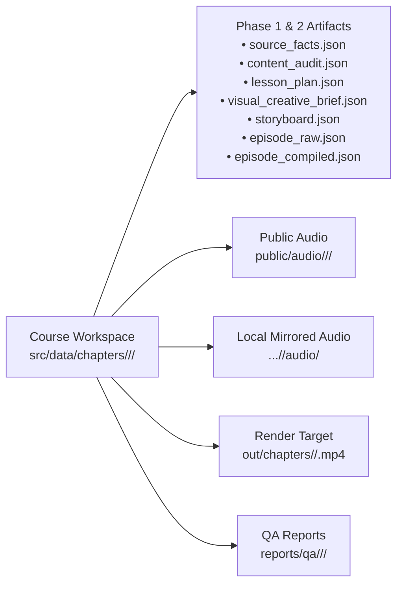
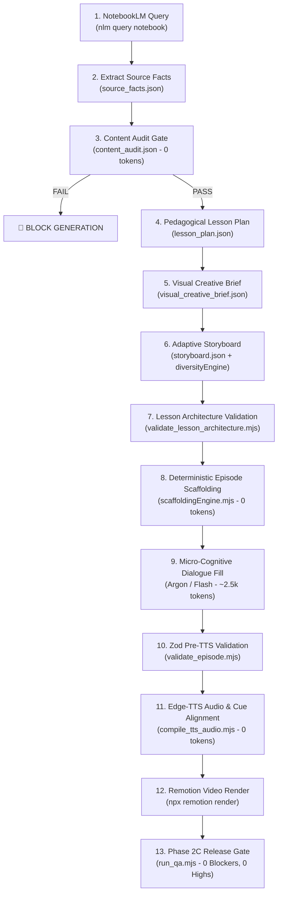

# AGENTS.md — Autonomous Course-to-Video Engine Operating Protocol

This document serves as the permanent system instructions for the Antigravity Agent. Whenever generating, compiling, validating, or rendering educational video lessons, execute this autonomous workflow end-to-end.

---

## 1. Purpose and Non-Negotiable Principles

The engine converts authoritative book sources into animated, narration-synchronized, broadcast-grade educational videos using Remotion. Every lesson is governed by six non-negotiable principles:

1. **Source Grounding & Comprehensive Extraction Invariant**:
   The original uploaded book source is the authoritative foundation of author teachings. Gemini NotebookLM (`nlm`) serves as the source-extraction assistant. The structured fact ledger ([`source_facts.json`](src/schemas/sourceLessonSchemas.mjs)) is the sole approved production input for lesson design.
   - **Mandatory Argon Reasoning per Chapter**: Gemini 4 Argon (`http://127.0.0.1:8001`) MUST be invoked for **every single chapter part** of any book being converted. Skipping Argon or falling back to generic/static templates across chapters is strictly prohibited as a quality violation.
   - **Exhaustive Knowledge Preservation**: Extraction is NOT capped at a superficial 6–8 facts. Argon must extract an exhaustive fact ledger (typically 10–20+ deep facts, definitions, exact mathematical formulas, volume/price thresholds, case studies, nuances, and source citations) directly from the NotebookLM context (`notebook_context.txt`). The end user must NEVER need to open the physical book themselves because all authoritative author knowledge is fully captured and taught.
   - **Distinct Character Dialogue Synthesis**: Argon must synthesize distinct, chapter-unique dialogues for Hindi (`Raju` & `Sharma ji`) and English (`Alex` & `Anna`) explicitly discussing the specific concepts, formulas, and real examples of that exact chapter part.
   - **Mandatory Problem-First Front Hook & Concrete Dilemma**: Every chapter across every course MUST begin in Scene 0 (`chat_story`) with a **concrete real-world failure, trader struggle, or historical dilemma** (see [`src/templates/CANONICAL_SCRIPT_SOUL.md`](src/templates/CANONICAL_SCRIPT_SOUL.md)).
     - *Dry, straightforward textbook definitions at the start are strictly prohibited as quality violations.*
     - **Scene 0 (4 beats)**:
       * `b01`: Raju/Alex asks about a practical trading struggle, failure mode, or market trap.
       * `b02`: Sharma ji/Marcus introduces the **concrete relatable situation & actors** (e.g., Hull: 1848 Midwest corn farmers; Murphy: Retail investor buying on record quarterly earnings).
       * `b03`: Sharma ji/Marcus reveals the **existential trap / crisis** (e.g., Hull: Bumper crop crashes prices, drought surges costs; Murphy: Earnings reports lag by 3 months while smart money already dumped the stock, causing 30% blindside loss).
       * `b04`: Sharma ji/Marcus introduces the **author's conceptual invention & solution** (e.g., Hull: 1848 CBOT standardized forward contracts; Murphy: Charles Dow & John Murphy established price action discounts all fundamentals in advance, so watching the chart warns you weeks before the news).
     - **Scene 1 (`tug_of_war`, 3 beats)**: Pits the two opposing market pressures from that opening dilemma against each other.
     - **Scene 2 (`progressive_cards`, 4 beats)**: Outlines the 4 structural solution pillars.
     - **Scenes 3–8**: Concrete technical rules, geometry, indicators, and calculations with real numbers solving that problem.
     - **Scene 9 (`interactive_quiz`, 3 beats)**: Practical scenario ($\ge 18$ words) testing how to avoid the opening failure.
     - **Scene 10 (`chat_story`)**: Mentor cautionary wisdom tying directly back to the opening dilemma.
     - **Scene 11 (`summary_thread`, 6 beats)**: 8 crisp rules codifying the solution.
2. **Domain Decoupling & Config-Driven Visuals**:
   The shared rendering engine is completely domain-agnostic. Visual templates, formatting, units, themes, personas, and pedagogical rules are defined in course configuration ([`src/courses/<course_id>.json`](src/courses/hull_derivatives.json)) and the visual template registry ([`src/templates/registry/templateRegistry.ts`](src/templates/registry/templateRegistry.ts)). Domain-specific behavior is isolated in optional domain modules ([`src/domain/finance/`](src/domain/finance/financeValidation.mjs)).
3. **Structured Cue Synchronization**:
   Visual state progression is driven by structured narration cues (`visualCues`) anchored to measured audio timestamps—never by parsing spoken text for symbols/numbers or arbitrary percentage interpolation.
4. **Task-Centric Execution Hierarchy & Quota Preservation**:
   Execution is organized into a strict task-centric hierarchy: **Deterministic Scripts (0 tokens) $\longrightarrow$ Cached Artifacts (0 tokens) $\longrightarrow$ Cline Worker (free/local inference) $\longrightarrow$ Gemini 4 Argon Proxy (cognitive reasoning) $\longrightarrow$ Antigravity Gemini 3.8 Flash (strictly IDE-internal fallback)**. Calling external Google GenAI SDK scripts with `GEMINI_API_KEY` is strictly prohibited.
5. **Adaptive Story-to-Visual Intelligence**:
   Visual consistency is mandatory; repeating identical scene templates across courses is not. Story, concept topology, and subject domain dictate the visual language through a Three-Level Template Architecture (Level 1 Existing, Level 2 Composite Layout, Level 3 Controlled Lifecycle).
6. **Single Unified Quality Release Gate**:
   A video is never released merely because an MP4 container exists. Deployment requires passing the domain-independent Phase 2C Release Gate ([`node scripts/run_qa.mjs`](scripts/run_qa.mjs)) with 0 Blockers and 0 Highs.

7. **Inviolable Bespoke Visual Synchronization & Zero-Stale-Boilerplate Invariant**:
   Visual presentation cards (`ui_state.cards`), character chat dialogues (`ui_state.messages`), comparison columns (`ui_state.leftColumn`/`rightColumn`), mathematical expressions, and summary steps MUST be 100% bespoke, authored second-by-second to match the exact spoken narration of that specific chapter, part, orientation, or synthesis video.
   - **Zero Tolerance for Scaffolding Leakage**: Inheriting or copy-pasting placeholder text from Chapter 1 baseline templates (e.g., 1848 Midwest corn farmers, lagging earnings reports, bilateral vs OTC default, or generic rule summaries) into any other chapter, part, orientation, or synthesis is an immediate `BLOCKER` violation.
   - **Automated Anti-Boilerplate Release Gate**: Both [`scripts/validate_episode.mjs`](scripts/validate_episode.mjs) and [`scripts/run_qa.mjs`](scripts/run_qa.mjs) strictly scan the full AST/JSON of all `ui_state` and `visual` objects. Any presence of un-replaced scaffolding boilerplate or semantic desync between spoken text and on-screen cards immediately fails validation with exit code 1.
   - **Universal Book Modularity Across All Types**:
     * **Standard Chapters & Parts**: Every single part must derive its opening struggle, comparison labels, and progressive cards directly from that specific chapter's extracted facts.
     * **Beginner's Orientation Video (`orientation`)**: A dedicated ~5-minute intro video watched *before* Chapter 1 to dismantle intimidation, bust the casino myth, reveal the 4 superpowers of the book, and outline the reader journey with 100% tailored cards.
     * **Whole-Book Dialectical Synthesis (`synthesis`)**: A comprehensive capstone showing why each chapter exists as a dialectical chain of inventions solving the fatal real-world failure of the prior tool, with 100% bespoke evolutionary cards, formulas, and rules.

8. **Interactive Quiz & Summary Thread Presentation Invariants**:
   - **Scene 9 (`interactive_quiz`) Full Options Invariant**:
     * Every interactive quiz scene MUST have exactly 3 beats:
       * `b01` (Question Posing): Question card + 4 multiple-choice options (`A`, `B`, `C`, `D`) displayed in a clean 2x2 interactive grid.
       * `b02` (Thinking Pause): Options remain visible while the animated *"PAUSE AND CONSIDER"* thinking spinner runs.
       * `b03` (Answer Reveal): The correct option card is highlighted in vivid emerald green with a checkmark badge (`CheckCircle2`), non-selected options dim to 45% opacity, and a detailed explanatory banner displays below.
     * `ui_state.options` MUST contain exactly 4 distinct options with letter prefixes (`A`, `B`, `C`, `D`). Missing options, blank cards, or skipping option rendering in the React template is an immediate `BLOCKER` quality violation.
   - **Scene 11 (`summary_thread`) Zero-Object-Serialization Invariant**:
     * Summary steps MUST NEVER produce `[object Object]` on screen.
     * Both structured step objects (`{ number, title, description, rule }`) and delimited strings (`"1. Title: Description"`) must be supported polymorphically and unpacked into rich visual cards (rule badge, bold title, descriptive rationale).
     * Any presence of literal `"[object Object]"` in AST, JSON, UI states, or rendered output is an immediate `BLOCKER` failure in `validate_episode.mjs` and `run_qa.mjs`.

---

## 2. Stable Course & Chapter Workspaces and Artifact Ownership

All chapter production data is strictly partitioned into isolated, book-grouped workspaces. Shared root production paths are strictly deprecated and reserved for non-production test fixtures.



### Stable Model-Neutral Path Conventions
Model names (`argon`, `flash`) must **never** appear in folder names, chapter IDs, audio paths, video filenames, UI breadcrumbs, or QA paths. The canonical paths are:

- **Workspace Data Directory**: `src/data/chapters/<course_id>/<chapter_id>/`
- **Public Audio Assets**: `public/audio/<course_id>/<chapter_id>/`
- **Mirrored Audio Directory**: `src/data/chapters/<course_id>/<chapter_id>/audio/`
- **Rendered MP4 Video**: `out/chapters/<course_id>/<chapter_id>.mp4`
- **QA Release Gate Reports**: `reports/qa/<course_id>/<chapter_id>/qa_report.json` and `qa_report.html`

### Required Chapter Artifacts (Zero Legacy Exemptions)
Inside every chapter directory `src/data/chapters/<course_id>/<chapter_id>/`, the engine strictly maintains 7 core artifacts:

| Artifact | Schema Reference | Responsibility & Invariants |
| :--- | :--- | :--- |
| **`source_facts.json`** | [`SourceFactsSchema`](src/schemas/sourceLessonSchemas.mjs) | Structured extraction preserving claims, definitions, formulas, variables, units, citations, and source IDs. |
| **`content_audit.json`** | [`ContentAuditSchema`](src/schemas/sourceLessonSchemas.mjs) | Pre-generation gate checking coverage, prerequisites, numerical examples, formulas, and domain rules. Status: `PASS`, `CONDITIONAL_PASS`, or `FAIL`. |
| **`lesson_plan.json`** | [`LessonPlanSchema`](src/schemas/sourceLessonSchemas.mjs) | Pedagogical blueprint, learning outcomes, misconception rebuttals, and active recall scenario grounded in `sourceFactIds`. |
| **`visual_creative_brief.json`** | [`VisualCreativeBriefSchema`](src/schemas/sourceLessonSchemas.mjs) | Chapter visual direction: narrative style, visual metaphors, composition strategy, and Level 1/2/3 template selection plan. |
| **`storyboard.json`** | [`StoryboardSchema`](src/schemas/sourceLessonSchemas.mjs) | Scene-by-scene sequence mapping visual template kinds and beat outlines to approved `sourceFactIds`. |
| **`episode_raw.json`** | [`EpisodeDataSchema`](src/data/schema_reference.json) | High-fidelity episode payload with `scenes`, `beats`, `ui_state`, and typed `visual` specifications. |
| **`episode_compiled.json`** | [`EpisodeDataSchema`](src/data/schema_reference.json) | Compiled production payload with measured `audioDurationSec`, `durationInFrames`, `audioFile`, and aligned cues. |

---

## 3. Token-Efficient Microkernel & Multi-Tier Execution Architecture

```mermaid
flowchart TD
    REQ["Trigger / Task Ingestion"] --> TC["Task Classifier\n(src/orchestrator/taskClassifier.mjs)"]
    TC --> CM["Context Manager\n(src/orchestrator/contextManager.mjs)"]
    CM --> CACHE{"Cache Check\nArtifact valid?"}
    
    CACHE -->|Hit (0 tokens)| REUSE["Reuse Valid Artifact"]
    CACHE -->|Miss| ROUTER["Execution Router\n(src/orchestrator/executionRouter.mjs)"]
    
    ROUTER -->|Tier 1 (0 tokens)| DET["Deterministic Node.js\n• Scaffolding Engine (0 tokens)\n• Edge-TTS (0 tokens)\n• Zod Validators\n• Remotion & QA"]
    ROUTER -->|Tier 2 (Free/Local)| CLINE["Cline Execution Worker\n• NVIDIA NIM / OpenRouter Free\n• Mechanical refactor & builders"]
    ROUTER -->|Tier 3 (Reasoning)| ARGON["Gemini 4 Argon Proxy\n• http://127.0.0.1:8001/v1\n• Low / Medium / High Thinking"]
    ROUTER -->|Tier 4 (Approved Fallback)| FLASH["Antigravity Gemini 3.8 Flash\n• Strictly IDE Internal Execution\n• Explicit User Approval Required"]

    REUSE --> GATE["Common Quality Gate (Zod + Content Audit + QA)"]
    DET --> GATE
    CLINE --> GATE
    ARGON --> GATE
    FLASH --> GATE
    GATE --> LEDGER["Execution Ledger & Telemetry\n(reports/telemetry/execution_ledger.jsonl)"]
```

### 3.1 Central Task Execution Router & Classification Matrix
Every task is evaluated by `classifyTask()` ([`src/orchestrator/taskClassifier.mjs`](src/orchestrator/taskClassifier.mjs)) before model invocation:

| Task Category | Complexity | Execution Engine | Token Cost |
| :--- | :--- | :--- | :---: |
| **Content Audit / Schema Validation** | Deterministic | Node.js / Zod | **0** |
| **Episode Scaffolding (12 Scenes)** | Deterministic | `scaffoldingEngine.mjs` | **0** |
| **Audio Compilation & Cue Timing** | Deterministic | Edge-TTS + `music-metadata` | **0** |
| **Video Rendering & Phase 2C QA** | Deterministic | Remotion + `run_qa.mjs` | **0** |
| **Builder Scripts / Mechanical Code** | Mechanical Dev | Cline (NVIDIA NIM / OpenRouter / Ollama) | **Free / Local** |
| **Visual Diversity Evaluation** | Deterministic | `diversityEngine.mjs` | **0** |
| **Targeted Dialogue Synthesis (Act 1)** | Micro-Reasoning | Argon Low (Proxy) | ~800–1,200 |
| **Pedagogical Blueprinting (Act 2 & 5)**| Medium Pedagogy | Argon Medium (Proxy) | ~2,500–3,500 |
| **Mathematical Proofs & Crisis Math** | Deep Reasoning | Argon High (Proxy) | ~1,200–2,000 |

### 3.2 Cline Execution Adapter Protocol
Cline operates as a sandboxed **Mechanical Execution Worker**, never the central orchestrator:
- **Location & Settings**: Managed via `C:\Users\YashAggarwal\.cline` with OpenAI-compatible providers (NVIDIA NIM, OpenRouter `:free` tier, or local Ollama).
- **Communication Protocol**: Interacts via structured JSON task manifests in `.cline/tasks/` produced by [`contextManager.mjs`](src/orchestrator/contextManager.mjs).
- **Scope Boundary**: Cline is authorized for writing deterministic builder scripts, unit test scaffolding, documentation sync, and mechanical schema refactoring. Cline is strictly prohibited from altering architecture contracts, modifying QA severity thresholds, or calling external APIs.
- **Pre-Commit Verification**: All Cline task completions must pass `validate_episode.mjs` or `npm run validate:lesson` before ingestion into production.

### 3.3 Gemini 4 Argon Execution via free-gemini-api
**Standard developer API keys (`GEMINI_API_KEY`) DO NOT have access to Gemini 4 Argon.**
Argon access is **exclusively powered by the local `free-gemini-api` proxy engine**:
- **Repository Location**: `../free-gemini-api`
- **Core Engine Executable**: `../free-gemini-api/gemini-core-windows-amd64.exe`
- **REST Endpoint**: `http://127.0.0.1:8001/v1/chat/completions`
- **Health Check**: `http://127.0.0.1:8001/health`
- **Thinking Matrix**: `gemini-4-argon` (Low), `gemini-4-argon-thinking-medium` (Medium), `gemini-4-argon-thinking-high` (High).
- **Mandatory Chapter Coverage Invariant**: Argon MUST be invoked for every chapter to extract an exhaustive fact ledger (10–20+ deep facts) from `notebook_context.txt` and generate tailored, nuanced dialogues for each scene. No chapter may be silently bypassed with hardcoded dialogue or facts.

### 3.4 Unified Fallback Policy & Zero-Leakage Guarantee
1. **Interactive Single-Chapter Mode**:
   If the local Argon proxy is offline and direct cookie sessions are missing, the engine **must halt immediately** with exit code 2 and prompt verbatim:
   ```text
   Argon is unavailable. Would you like me to continue this chapter with Gemini 3.8 Flash?
   ```
2. **Batch / Unattended Mode**:
   Gemini 3.8 Flash fallback is only invoked if `--confirm-flash` was explicitly provided at launch. Otherwise, the chapter is cleanly skipped with logged telemetry.
3. **Absolute Ban on External GenAI SDK Calls**:
   Gemini 3.8 Flash is executed **strictly within the Antigravity IDE**. Calling `@google/genai` with external API keys in standalone scripts is completely decommissioned.

### 3.5 Deterministic 12-Scene Scaffolding Engine
Instead of generating 12 scenes in a single 40,000-token prompt, [`scaffoldingEngine.mjs`](src/orchestrator/scaffoldingEngine.mjs) generates the complete Cognitive Micro-Kernel structure deterministically with **0 tokens**:
- Sets segment indices, template kinds, badge labels, and theme colors.
- Builds empty beat shells, stage directions, and UI states.
- Instantiates the strict 8-rule summary sequence (`[0,0]`, `[1,2]`, `[3,4]`, `[5,6]`, `[7,8]`, `compactOverview`).
- Passes 100% of [`validate_episode.mjs`](scripts/validate_episode.mjs) with zero errors.
- Argon or Flash is then queried only for targeted dialogue lines (~2,500 tokens total per chapter, a 90% reduction).

### 3.6 Execution Telemetry & Token Ledger
Every operation is recorded in [`reports/telemetry/execution_ledger.jsonl`](reports/telemetry/execution_ledger.jsonl) with exact tokens used, cost, engine provenance, duration, and verified token savings.

---

## 4. Adaptive Story-to-Visual Intelligence & Dynamic Template Engine

### 4.1 Visual Storytelling Principle
Visual consistency is mandatory; repeating identical scene compositions across every course is not.
The story determines the visual language:
- **Technical Analysis**: Dynamic order book DOM, candlestick evolution, trendline bounces.
- **Options & Derivatives**: Payoff profile curves, strike progression, margin wipeout cascades.
- **Computer Science**: Call-stack architecture, heap allocation, pointer mutation animations.
- **Physics / Mechanics**: Free-body diagrams, vector trajectories, energy transfer curves.

### 4.2 Three-Level Template Intelligence
```mermaid
flowchart LR
    STORY["Lesson Story & Concept Topology"] --> EVAL{"Template Intelligence"}
    EVAL -->|Level 1 (~80%)| L1["Level 1: Existing Template Selection\n(TEMPLATE_REGISTRY + custom data & cues)"]
    EVAL -->|Level 2 (~15%)| L2["Level 2: Dynamic Composition\n(CompositeLayout.tsx - Split / Stacked Views)"]
    EVAL -->|Level 3 (~5%)| L3["Level 3: Controlled Template Lifecycle\n(verify_new_template.mjs -> Registry)"]
```

1. **Level 1 — Existing Template Selection**:
   The model selects from `TEMPLATE_REGISTRY` based on concept topology with custom data, theme, and narration cues.
2. **Level 2 — Dynamic Multi-Component Composition (`composite_layout`)**:
   Enables combining two existing tested Remotion components using [`CompositeLayout.tsx`](src/templates/CompositeLayout.tsx) (e.g. Chart on left + Formula proof on right). Declarative JSON structure; 0 new React files required.
3. **Level 3 — Controlled New Template Lifecycle**:
   When a genuine pedagogical capability gap exists, a new template progresses through the 10-step lifecycle:
   $$\text{PROPOSED} \to \text{DESIGN SPEC} \to \text{CODE GEN} \to \text{SCHEMA VALIDATION} \to \text{REMOTION PREVIEW} \to \text{QA GATE} \to \text{REGISTRY APPROVED}$$
   Verified via `node scripts/verify_new_template.mjs` before admission.

### 4.3 Visual Diversity & Anti-Repetition Engine (`diversityEngine.mjs`)
[`diversityEngine.mjs`](src/orchestrator/diversityEngine.mjs) calculates a mathematical diversity score before storyboard approval:
- **No Consecutive Identical Templates**: Adjacent scenes must not use the same template unless explicitly flagged as `pedagogicalContinuation: true`.
- **Saturation Cap**: No single template may exceed 30% of total scenes in a chapter part.
- **Variety Threshold**: Every chapter part must employ at least 5 distinct visual templates.

---

## 5. Course Production Workflow



---

## 6. Rendering and Unified QA Release Gate

### 6.1 Video Rendering via Remotion
```bash
npx remotion render src/index.ts EpisodeComposition out/chapters/<course_id>/<chapter_id>.mp4 --props=src/data/chapters/<course_id>/<chapter_id>/episode_compiled.json --crf=16 --pixel-format=yuv420p
```

### 6.2 Release Gate Protocol (`scripts/run_qa.mjs`)
Release requires passing the Phase 2C Release Gate:
- **`BLOCKER`**: Prohibits release. (Missing audio, corrupt container, schema violation, placeholder formula, duration drift $>10\text{s}$, content audit fail, literal `[object Object]` detected anywhere in payload, missing 4 multiple-choice options in `interactive_quiz`).
- **`HIGH`**: Prohibits release unless `--allow-high` is explicitly granted. (Duration drift $>1.0\text{s}$, unlabelled hypothetical scenario, quiz $<18$ words, cue timing mismatch).
- **`MEDIUM`**: Telemetry review; non-blocking. (Subtitle $>16$ words, summary step $>30$ words, minor drift $0.5\text{s}–1.0\text{s}$).

---

## 7. Operational Modes with Verified Commands

### 1. Full Autonomous Video Generation
```bash
# Generate video with token-efficient microkernel (default):
npm run make-video -- ch01_part1

# Generate video for Hull chapter:
npm run make-video -- "hull ch01_part1"

# Generate with explicit Flash approval if Argon is unavailable:
npm run make-video -- ch01_part1 --confirm-flash

# Force overwrite existing data:
npm run make-video -- ch02_part1 --force

# Use legacy monolithic generator (deprecated):
npm run make-video -- ch01_part1 --legacy-monolith
```

### 2. Validation & Quality Assurance
```bash
# Validate lesson architecture across all 64 chapters:
npm run validate:lesson

# Validate specific chapter episode schema:
node scripts/validate_episode.mjs --dir=src/data/chapters/hull_derivatives/ch01_part1

# Run QA Release Gate on a specific chapter:
node scripts/run_qa.mjs --dir=src/data/chapters/hull_derivatives/ch01_part1

# Run QA Release Gate across all chapters:
npm run qa:all -- --allow-high
```

### 3. Architecture & Test Suites
```bash
# Run Token-Efficient Microkernel Test Suite:
node scripts/test_execution_router.mjs

# Run Adaptive Story-to-Visual Intelligence Test Suite:
node scripts/test_part13_adaptive_intelligence.mjs

# Verify a newly proposed Level 3 template:
node scripts/verify_new_template.mjs
```

### 4. Audio Compilation & Synthesis
```bash
# Compile audio using free Edge-TTS (0 tokens, default):
node scripts/compile_tts_audio.mjs --dir=src/data/chapters/hull_derivatives/ch01_part1 --force
```

---

## 8. Authoritative Repository File Map

### Orchestration & Microkernel Core
- [`src/orchestrator/taskClassifier.mjs`](src/orchestrator/taskClassifier.mjs): Evaluates complexity and categorizes tasks into deterministic, Cline, or reasoning tiers.
- [`src/orchestrator/contextManager.mjs`](src/orchestrator/contextManager.mjs): Slices schemas and facts to eliminate prompt bloat; builds Cline manifests.
- [`src/orchestrator/scaffoldingEngine.mjs`](src/orchestrator/scaffoldingEngine.mjs): 0-token deterministic 12-scene Cognitive Micro-Kernel episode generator.
- [`src/orchestrator/executionRouter.mjs`](src/orchestrator/executionRouter.mjs): Hierarchical router enforcing deterministic priority and zero external API leakage.
- [`src/orchestrator/executionLedger.mjs`](src/orchestrator/executionLedger.mjs): Telemetry logging and quantifiable token savings tracker.
- [`src/orchestrator/diversityEngine.mjs`](src/orchestrator/diversityEngine.mjs): Visual diversity scoring, anti-repetition guards, and adaptive concept topology recommendations.

### Templates & Level 2 Composition
- [`src/templates/registry/templateRegistry.ts`](src/templates/registry/templateRegistry.ts): Universal visual template registry.
- [`src/templates/TemplateRenderer.tsx`](src/templates/TemplateRenderer.tsx): Master Remotion template dispatcher.
- [`src/templates/CompositeLayout.tsx`](src/templates/CompositeLayout.tsx): Level 2 multi-component dynamic composition renderer.

### Schemas & Course Configurations
- [`src/schemas/sourceLessonSchemas.mjs`](src/schemas/sourceLessonSchemas.mjs): Schemas for `source_facts.json`, `content_audit.json`, `lesson_plan.json`, `visual_creative_brief.json`, and `storyboard.json`.
- [`src/schemas/templateRegistrySchema.mjs`](src/schemas/templateRegistrySchema.mjs): Definitions for template registry and data types.
- [`src/schemas/visualSpecSchema.mjs`](src/schemas/visualSpecSchema.mjs): Visual kind schemas and cue specifications.
- [`src/courses/hull_derivatives.json`](src/courses/hull_derivatives.json): Futures & options course configuration.
- [`src/courses/murphy_technical_analysis.json`](src/courses/murphy_technical_analysis.json): Technical analysis course configuration.

### Production & Validation Scripts
- [`scripts/generate_video.mjs`](scripts/generate_video.mjs): Master video generation entrypoint integrating the microkernel router.
- [`scripts/extract_source_facts.mjs`](scripts/extract_source_facts.mjs): Extracts facts from NotebookLM into `source_facts.json`.
- [`scripts/audit_content.mjs`](scripts/audit_content.mjs): Deterministic content auditor emitting `content_audit.json`.
- [`scripts/generate_lesson_storyboard.mjs`](scripts/generate_lesson_storyboard.mjs): Generates `lesson_plan.json`, `visual_creative_brief.json`, and `storyboard.json`.
- [`scripts/compile_tts_audio.mjs`](scripts/compile_tts_audio.mjs): Edge-TTS audio compiler with hash validation and phrase alignment.
- [`scripts/validate_episode.mjs`](scripts/validate_episode.mjs): Zod schema validator for episode payloads.
- [`scripts/validate_lesson_architecture.mjs`](scripts/validate_lesson_architecture.mjs): Validates Phase 1 artifacts across all chapters.
- [`scripts/run_qa.mjs`](scripts/run_qa.mjs): Phase 2C Release Gate QA runner.
- [`scripts/verify_new_template.mjs`](scripts/verify_new_template.mjs): Level 3 template quality gate validator.
