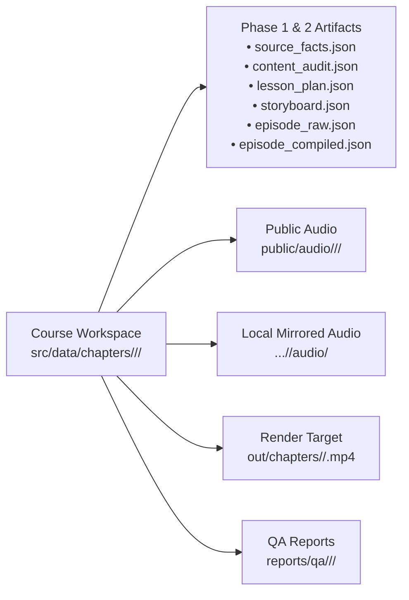
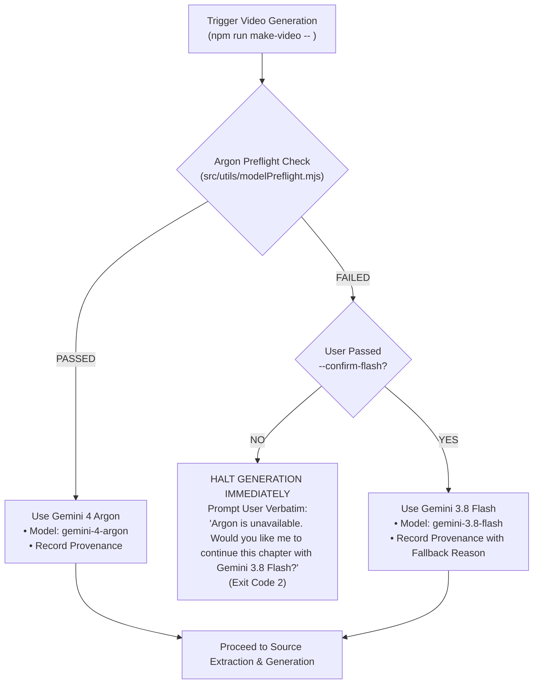
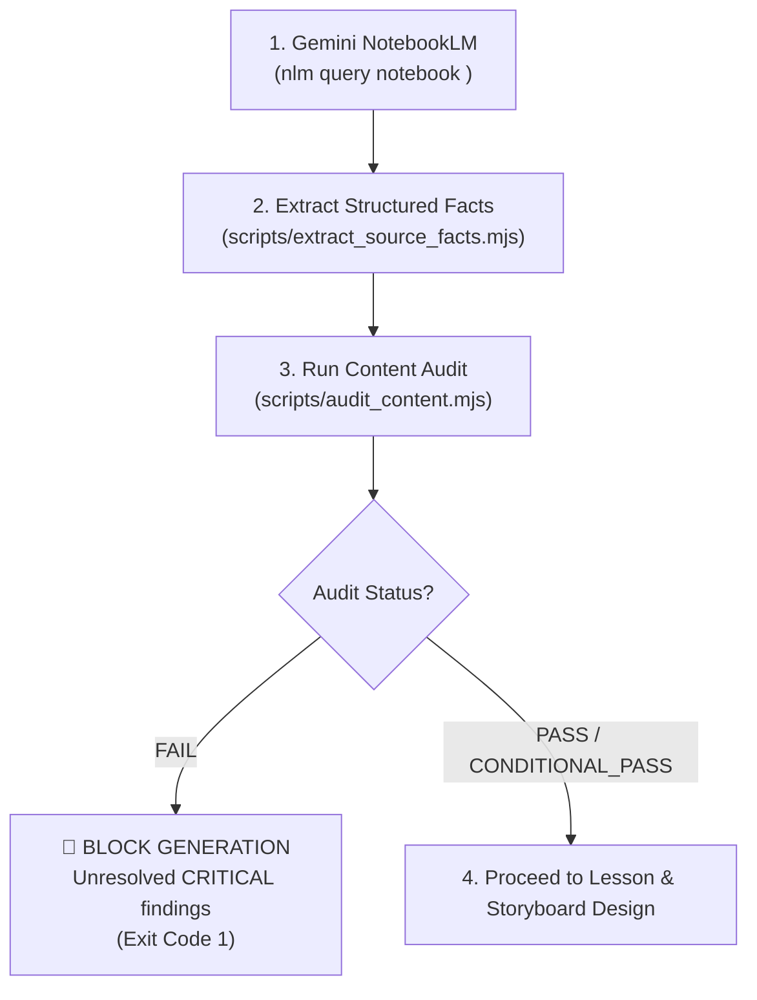
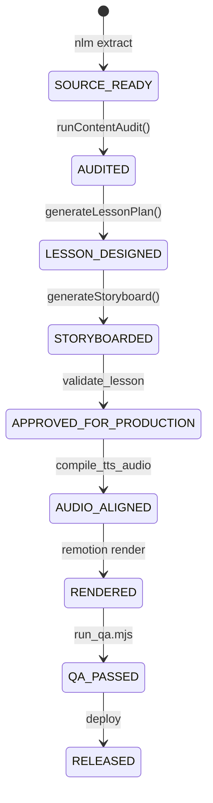

# AGENTS.md — Autonomous Course-to-Video Engine Operating Protocol

This document serves as the permanent system instructions for the Antigravity Agent. Whenever generating, compiling, validating, or rendering educational video lessons, execute this autonomous workflow end-to-end.

---

## 1. Purpose and Non-Negotiable Principles

The engine converts authoritative book sources into animated, narration-synchronized, broadcast-grade educational videos using Remotion. Every lesson is governed by four non-negotiable principles:

1. **Source Grounding & Anti-Fabrication Invariant**:
   The original uploaded book source is the authoritative foundation of author teachings. Gemini NotebookLM (`nlm`) serves as the source-extraction assistant. The structured fact ledger ([`source_facts.json`](src/schemas/sourceFactsSchema.ts)) is the sole approved production input for lesson design. The agent must never hallucinate formulas, numbers, citations, or concepts, nor replace missing domain knowledge with generic boilerplate.
2. **Domain Decoupling & Config-Driven Visuals**:
   The shared rendering engine is completely domain-agnostic. Visual templates, formatting, units, themes, personas, and pedagogical rules are defined in course configuration ([`src/courses/<course_id>.json`](src/courses/murphy_technical_analysis.json)) and the visual template registry ([`src/templates/registry/templateRegistry.ts`](src/templates/registry/templateRegistry.ts)). Domain-specific behavior (e.g., technical analysis candlesticks or options payoff math) is isolated in optional domain modules ([`src/domain/finance/`](src/domain/finance/financialCalculators.ts)).
3. **Structured Cue Synchronization**:
   Visual state progression is driven by structured narration cues (`visualCues`) anchored to measured audio timestamps—never by parsing spoken text for symbols/numbers or arbitrary percentage interpolation.
4. **Single Unified Quality Release Gate**:
   A video is never released merely because an MP4 container exists. Deployment requires passing the domain-independent Phase 2C Release Gate ([`node scripts/run_qa.mjs`](scripts/run_qa.mjs)).

---

## 2. Stable Course & Chapter Workspaces and Artifact Ownership

All chapter production data is strictly partitioned into isolated, book-grouped workspaces. Shared root production paths are strictly deprecated and reserved for non-production test fixtures.



### Stable Model-Neutral Path Conventions
Model names (`argon`, `flash`) must **never** appear in folder names, chapter IDs, audio paths, video filenames, UI breadcrumbs, or QA paths. The canonical paths are:

- **Workspace Data Directory**: `src/data/chapters/<course_id>/<chapter_id>/`
- **Public Audio Assets**: `public/audio/<course_id>/<chapter_id>/`
- **Mirrored Audio Directory**: `src/data/chapters/<course_id>/<chapter_id>/audio/`
- **Rendered MP4 Video**: `out/chapters/<course_id>/<chapter_id>.mp4`
- **QA Release Gate Reports**: `reports/qa/<course_id>/<chapter_id>/qa_report.json` and `qa_report.html`

### Required Chapter Artifacts (Zero Legacy Exemptions)
Inside every chapter directory `src/data/chapters/<course_id>/<chapter_id>/`, the engine strictly maintains 6 core artifacts:

| Artifact | Schema Reference | Responsibility & Invariants |
| :--- | :--- | :--- |
| **`source_facts.json`** | [`SourceFactsSchema`](src/schemas/sourceFactsSchema.ts) | Structured extraction preserving claims, definitions, formulas, variables, units, citations, and source IDs. |
| **`content_audit.json`** | [`ContentAuditSchema`](src/schemas/contentAuditSchema.ts) | Pre-generation gate checking coverage, prerequisites, numerical examples, formulas, and domain rules. Status: `PASS`, `CONDITIONAL_PASS`, or `FAIL`. |
| **`lesson_plan.json`** | [`LessonPlanSchema`](src/schemas/lessonPlanSchema.ts) | Pedagogical blueprint, learning outcomes, misconception rebuttals, and active recall scenario grounded in `sourceFactIds`. |
| **`storyboard.json`** | [`StoryboardSchema`](src/schemas/storyboardSchema.ts) | Scene-by-scene sequence mapping visual template kinds and beat outlines to approved `sourceFactIds`. |
| **`episode_raw.json`** | [`EpisodeDataSchema`](src/data/schema_reference.json) | High-fidelity episode payload with `scenes`, `beats`, `ui_state`, and typed `visual` specifications. |
| **`episode_compiled.json`** | [`EpisodeDataSchema`](src/data/schema_reference.json) | Compiled production payload with measured `audioDurationSec`, `durationInFrames`, `audioFile`, and aligned cues. |

---

## 3. Model Preflight and Explicit Flash Fallback Approval

The primary generation model is **Gemini 4 Argon** (`gemini-4-argon`), utilizing the authenticated local web-session proxy or cookie session. The engine operates under a strict, non-negotiable model fallback policy.



### Operational Rules for Model Selection
1. **Mandatory Preflight Check**:
   Before initiating source fact extraction, script synthesis, TTS generation, or rendering, the engine executes `checkArgonPreflight()`.
2. **Never Silently Downgrade**:
   If Argon is unavailable, offline, or misconfigured, the engine **must halt immediately** before generating any content. It must never silently downgrade, switch models, or infer user intent.
3. **Exact Fallback Question**:
   The engine halts and outputs verbatim:
   ```text
   Argon is unavailable. Would you like me to continue this chapter with Gemini 3.8 Flash?
   ```
4. **Explicit User Approval**:
   Gemini 3.8 Flash is only invoked after the user explicitly confirms (e.g. re-running with the `--confirm-flash` flag).
5. **Generation Provenance Metadata**:
   Every generated episode and lesson plan records provenance metadata:
   ```json
   "generationProvenance": {
     "model": "gemini-4-argon",
     "requestedModel": "gemini-4-argon",
     "preflightStatus": "PASSED",
     "approvedByUser": true,
     "approvalTimestamp": "2026-11-03T01:45:00.000Z",
     "runId": "run_1762115100_a8f3b"
   }
   ```

---

## 4. Source Extraction and Content-Audit Gate



1. **NotebookLM Extraction**:
   - The engine queries the authorized notebook using `nlm query notebook <notebook_id> "<directive>" -s <source_id> --new-conversation --json`.
   - Results are saved to `<chapter_dir>/notebook_context.txt`.
2. **Fact Ledger Formulation**:
   - Run `node scripts/extract_source_facts.mjs --dir=src/data/chapters/<course_id>/<chapter_id>`.
   - Populates structured claims, variables, numerical details, and citations into `source_facts.json`.
3. **Content Audit Check**:
   - Run `node scripts/audit_content.mjs --dir=src/data/chapters/<course_id>/<chapter_id>`.
   - Inspects source coverage, prerequisites, missing definitions, formula variables, units, numerical consistency, and signs (+/- long/short).
   - If findings include any **CRITICAL** severity defect, audit status is `FAIL`. Generation and rendering are **strictly blocked**.

---

## 5. Lesson and Storyboard Approval Gate

Once `source_facts.json` passes audit, the lesson plan and storyboard are synthesized strictly from approved facts:

1. **Lesson Plan Generation**:
   - Run `node scripts/generate_lesson_storyboard.mjs --dir=src/data/chapters/<course_id>/<chapter_id>`.
   - Structures prerequisites, pedagogical sequence, core principles, misconceptions, and real-world active recall scenarios.
   - Every claim is tied to an explicit `sourceFactId`.
2. **Storyboard Formulation**:
   - Builds scene outlines, beat progressions, and visual template assignments.
   - Enforces visual variety: dynamic alternation between charts, cards, comparisons, diagrams, formulas, and quizzes.
3. **Lesson Architecture Validation Gate**:
   - Run `npm run validate:lesson` or `node scripts/validate_lesson_architecture.mjs`.
   - Checks that all 4 Phase 1 artifacts exist, are valid JSON, conform to Zod schemas, and have zero dangling `sourceFactIds`.

---

## 6. Generic Visual, Audio, Alignment, and Synchronization Contract

### 6.1 Generic Course Configuration & Template Registry
- Adding a new book or subject requires only a course configuration ([`src/courses/<course_id>.json`](src/courses/murphy_technical_analysis.json)) specifying theme colors, typography, allowed templates, and persona rules.
- **Zero TypeScript renderer code changes are permitted** when adding a new book.
- Visual components query [`TEMPLATE_REGISTRY`](src/templates/registry/templateRegistry.ts) for valid template targets and data schemas.

### 6.2 Structured Visual Specifications
Visual changes are driven by explicit beat-level `visual` data—never derived by scraping narration text:
```ts
visual: {
  kind: 'chart' | 'formula' | 'diagram' | 'comparison' | 'timeline' | 'process' | 'cards' | 'conversation' | 'quiz' | 'summary',
  data: unknown,
  semantics: {
    teachingObjective: string,
    sourceFactIds: string[],
    importantValues?: string[],
    relationships?: string[]
  }
}
```

### 6.3 Narration Visual Cues
Every visual state transition is synchronized via structured cues:
```ts
visualCues: [
  {
    atMs: number,
    action: 'reveal' | 'highlight' | 'draw' | 'emphasize' | 'subtitle',
    target: string,
    payload?: unknown
  }
]
```
Validated against template capabilities and measured narration audio duration.

### 6.4 Authoritative Audio Generation & Timing
- Run `node scripts/compile_tts_audio.mjs --dir=src/data/chapters/<course_id>/<chapter_id> --force`.
- Audio compiler computes deterministic SHA-256 hash (`narrationHash`) of sanitized `hindi_tts`. Stale audio is invalidated and regenerated.
- Measures exact audio duration using `music-metadata`.
- Exact beat duration is calculated from measured audio duration plus authored pause:
  $$\text{durationInFrames} = \max\left(15, \left\lceil \frac{\text{audioDurationSec} \cdot 1000 + \text{pauseAfterMs}}{1000} \cdot \text{FPS} \right\rceil\right)$$
- Audio assets are output to `public/audio/<course_id>/<chapter_id>/` and mirrored to `src/data/chapters/<course_id>/<chapter_id>/audio/`.

### 6.5 Phrase-Level Subtitle Alignment
- Audio compiler segments subtitles into `subtitlePhrases` with `startMs` and `endMs` timestamps.
- Video layout highlights the active phrase during playback, falling back safely to sentence-level display when alignment is absent.

---

## 7. Rendering and Generic QA Release Gate

### 7.1 Video Rendering via Remotion
Videos are rendered into isolated course directories:
```bash
npx remotion render src/index.ts EpisodeComposition out/chapters/<course_id>/<chapter_id>.mp4 --props=src/data/chapters/<course_id>/<chapter_id>/episode_compiled.json --crf=16 --pixel-format=yuv420p
```

### 7.2 Release Gate Verification (`scripts/run_qa.mjs`)
The release gate inspects data, timing, media, layout, and video container integrity:
```bash
node scripts/run_qa.mjs --dir=src/data/chapters/<course_id>/<chapter_id>
# Or across all chapters:
npm run qa:all -- --allow-high
```

### Severity Classification & Release Decision
- **`BLOCKER`**: Release must fail immediately. Rendering/deployment prohibited. (Missing audio, corrupt container, schema errors, duration mismatch > 10s, critical audit failures).
- **`HIGH`**: Release fails unless `--allow-high` is explicitly supplied. (Unresolved duration drift > 1s, domain rule violations, subtitle missing words).
- **`MEDIUM`**: Reported for pedagogical review. Does not block release. (Subtitle word count > 16 words, missing phrase-level alignment fallback).
- **`LOW`**: Informational telemetry. (Pending video render, styling suggestions).

Reports and screenshot cues are written to `reports/qa/<course_id>/<chapter_id>/`.

---

## 8. State Machine, Invalidation, Repair, and Human-Review Rules

Every chapter progresses through a formal, model-neutral state machine:



### Invalidation Triggers
- **Source Facts Invalidation**: Editing `source_facts.json` resets state to `SOURCE_READY`, invalidating `lesson_plan.json`, `storyboard.json`, and all downstream payloads.
- **Narration Text Invalidation**: Modifying `hindi_tts` invalidates cached audio via SHA-256 hash mismatch, requiring re-synthesis and frame re-calculation.
- **Timing Invalidation**: Duration drift $|\text{compiledFrames} - \text{measuredFrames}| > 15 \text{ frames}$ (500ms) triggers automated frame recalculation.

### Single-Pass Self-Correction Guard
- If Zod validation or layout collision occurs during generation, the agent applies code remediation and re-validates **strictly once**.
- If errors persist after one pass, the agent halts and surfaces the failure report to the user, strictly preventing infinite loops.

---

## 9. Operational Modes with Verified Commands

All commands operate on model-neutral paths:

### 1. Full Autonomous Video Generation
```bash
# Generate video for Murphy chapter:
npm run make-video -- ch01_part1

# Generate video for Hull chapter:
npm run make-video -- "hull ch01_part1"

# Generate with explicit Flash approval if Argon is unavailable:
npm run make-video -- ch01_part1 --confirm-flash

# Force overwrite existing data:
npm run make-video -- ch02_part1 --force
```

### 2. Validation & Quality Assurance
```bash
# Validate lesson architecture across all chapters:
npm run validate:lesson

# Validate specific chapter episode schema:
node scripts/validate_episode.mjs --dir=src/data/chapters/murphy_technical_analysis/ch01_part1

# Run QA Release Gate on a specific chapter:
node scripts/run_qa.mjs --dir=src/data/chapters/murphy_technical_analysis/ch01_part1

# Run QA Release Gate across all 36 chapters:
npm run qa:all -- --allow-high
```

### 3. Audio Compilation & Synthesis
```bash
# Compile audio for specific chapter:
node scripts/compile_tts_audio.mjs --dir=src/data/chapters/murphy_technical_analysis/ch01_part1 --force

# Compile using Gemini TTS:
node scripts/compile_tts_audio.mjs --dir=src/data/chapters/murphy_technical_analysis/ch01_part1 --tts=gemini --force
```

### 4. Interactive Studio & Manual Render
```bash
# Launch interactive Remotion preview studio:
npm run preview

# Render chapter video with explicit props:
npx remotion render src/index.ts EpisodeComposition out/chapters/murphy_technical_analysis/ch01_part1.mp4 --props=src/data/chapters/murphy_technical_analysis/ch01_part1/episode_compiled.json
```

---

## 10. Repository File Map

Every path links to an authoritative, verified file in the workspace:

### Engine Core & Path Resolvers
- [`src/utils/chapterPaths.mjs`](src/utils/chapterPaths.mjs): Path resolution for chapter workspaces, audio assets, videos, and QA reports.
- [`src/utils/chapterPaths.ts`](src/utils/chapterPaths.ts): TypeScript type bindings for path resolvers.
- [`src/utils/modelPreflight.mjs`](src/utils/modelPreflight.mjs): Mandatory Argon connectivity and session preflight check.

### Schemas & Course Configurations
- [`src/schemas/sourceFactsSchema.ts`](src/schemas/sourceFactsSchema.ts): Source fact extraction schema.
- [`src/schemas/contentAuditSchema.ts`](src/schemas/contentAuditSchema.ts): Content audit validation schema.
- [`src/schemas/lessonPlanSchema.ts`](src/schemas/lessonPlanSchema.ts): Pedagogical lesson plan schema.
- [`src/schemas/storyboardSchema.ts`](src/schemas/storyboardSchema.ts): Storyboard sequence schema.
- [`src/data/schema_reference.json`](src/data/schema_reference.json): Complete Remotion episode schema definition.
- [`src/courses/murphy_technical_analysis.json`](src/courses/murphy_technical_analysis.json): Technical analysis course configuration.
- [`src/courses/hull_derivatives.json`](src/courses/hull_derivatives.json): Futures & options course configuration.

### Template Registry & Domain Extensions
- [`src/templates/registry/templateRegistry.ts`](src/templates/registry/templateRegistry.ts): Universal registry of visual templates and animation targets.
- [`src/domain/finance/financialCalculators.ts`](src/domain/finance/financialCalculators.ts): Isolated financial calculators and domain rules.

### QA Release Gate
- [`src/qa/qaEngine.mjs`](src/qa/qaEngine.mjs): Domain-independent release gate evaluation engine.
- [`src/qa/qaTypes.ts`](src/qa/qaTypes.ts): QA report and findings type definitions.
- [`scripts/run_qa.mjs`](scripts/run_qa.mjs): CLI runner for release gate audits.

### Orchestration Scripts
- [`scripts/generate_video.mjs`](scripts/generate_video.mjs): End-to-end curriculum dispatcher with preflight check and Flash fallback.
- [`scripts/extract_source_facts.mjs`](scripts/extract_source_facts.mjs): Extracts facts from NotebookLM into `source_facts.json`.
- [`scripts/audit_content.mjs`](scripts/audit_content.mjs): Validates source facts and emits `content_audit.json`.
- [`scripts/generate_lesson_storyboard.mjs`](scripts/generate_lesson_storyboard.mjs): Generates `lesson_plan.json` and `storyboard.json`.
- [`scripts/compile_tts_audio.mjs`](scripts/compile_tts_audio.mjs): Authoritative audio compiler with hash validation and phrase alignment.
- [`scripts/validate_episode.mjs`](scripts/validate_episode.mjs): Zod schema validator for episode payloads.
- [`scripts/validate_lesson_architecture.mjs`](scripts/validate_lesson_architecture.mjs): Validates Phase 1 artifacts across all chapters.
