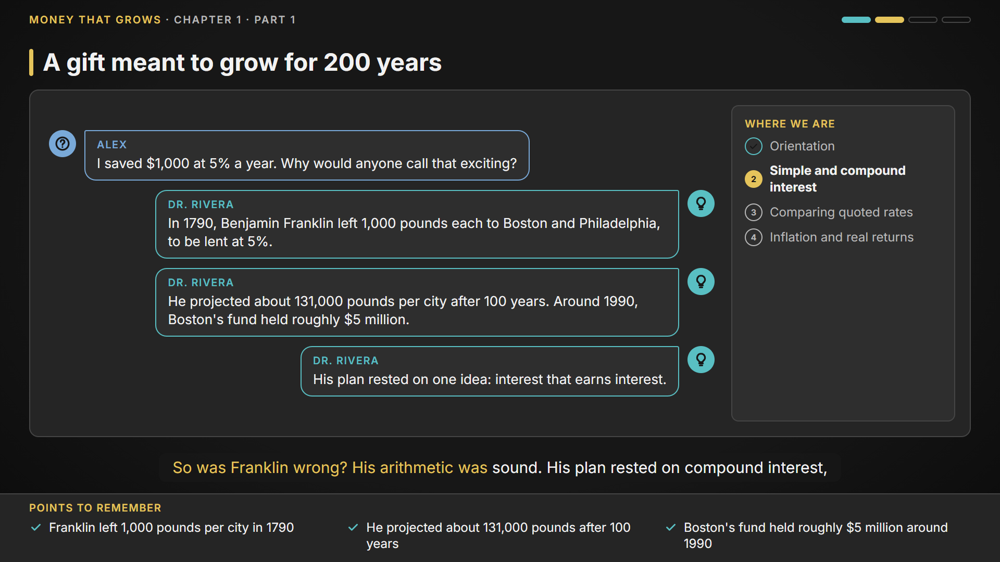
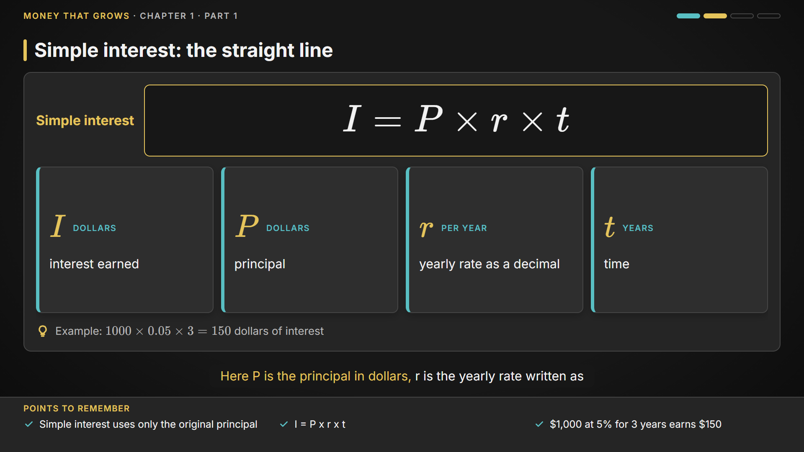
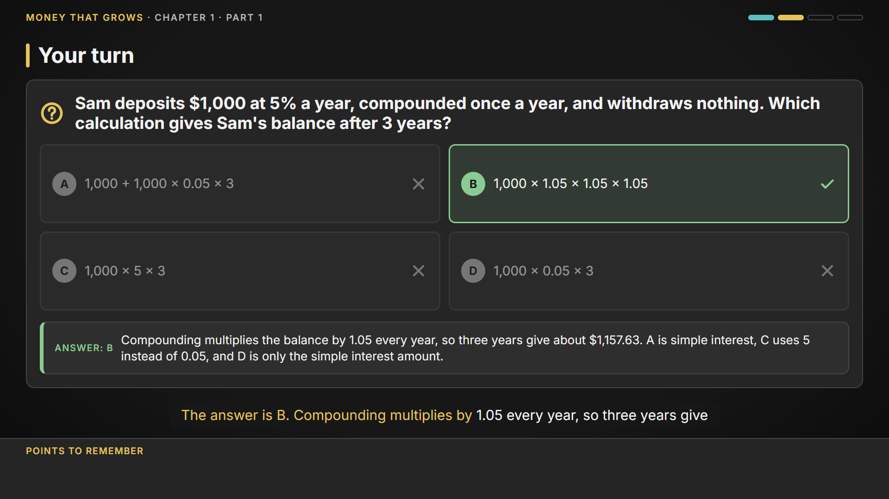
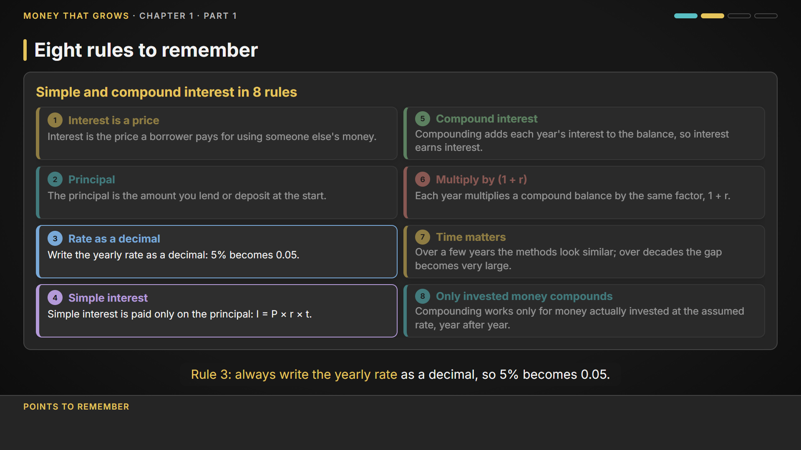

# OpenLectern

OpenLectern is an open-source, autonomous book-to-video lesson engine. It transforms books the user is entitled to use into broadcast-grade (1920x1080, 30 fps, H.264/AAC) educational videos, complete with synchronized narration, formula animations, step-by-step worked examples, and interactive quizzes.



## Highlights

- **Complete Curriculum Transformation**: Produces an Orientation video, per-chapter part videos, and an optional whole-book Synthesis video.
- **Dual Spoken Languages**: Simultaneous bilingual output (e.g. English and Hindi in Devanagari script) with identical visual timing.
- **Zero Paid Key Mode**: Operates out-of-the-box using coding agents in Agent-as-LLM mode or deterministic replay, plus free online Microsoft Edge TTS.
- **Rigorous 49-Check QA Gate**: Strict release gate preventing uncompiled LaTeX, arithmetic errors, off-canvas text overflow, or stale placeholders from ever reaching release media.
- **16 Educational Templates**: Domain-agnostic Remotion 4 components for progressive cards, formula breakdowns, causal chains, data charts, and interactive quizzes.

## Screenshots

| Formula Breakdown | Interactive Quiz | Summary Thread |
| :---: | :---: | :---: |
|  |  |  |

---

> 🍎 **Using a Mac?** See [MAC_QUICKSTART.md](MAC_QUICKSTART.md) or run `./scripts/setup_mac.sh` for an automated 1-command setup optimized for Apple Silicon (M1/M2/M3/M4/M5) and Intel Macs.

## 60-Second Quick Start

Prerequisites: Node.js 20+, Git. Optional: ffmpeg on PATH (falls back to `ffmpeg-static`).

### Windows PowerShell

```powershell
# Clone the repository
git clone https://github.com/openlectern/openlectern.git
cd openlectern

# Install dependencies (runs postinstall doctor)
npm install

# Run the 60-second deterministic replay quickstart
npm start -- --non-interactive --book demo --chapter ch01 --part p1 --lang en --llm replay --tts mock --draft
```

### macOS / Linux Bash

```bash
# Clone the repository
git clone https://github.com/openlectern/openlectern.git
cd openlectern

# Install dependencies
npm install

# Run the 60-second deterministic replay quickstart
npm start -- --non-interactive --book demo --chapter ch01 --part p1 --lang en --llm replay --tts mock --draft
```

The rendered draft video and its self-contained QA report will be written to `out/demo/drafts/`.

---

## CLI Commands

The OpenLectern CLI provides complete control over the pipeline and verification suite:

```bash
# System diagnostic check
npx openlectern doctor

# Interactive setup wizard
npx openlectern start

# Run the pipeline for a book or chapter
npx openlectern make --book demo --chapter ch01 --part p1

# Run a single stage in isolation
npx openlectern run S11 --book demo --chapter ch01 --part p1

# Run QA verification on an existing part or test fixture
npx openlectern qa --book demo --chapter ch01 --part p1

# List all 49 QA release gate checks
npx openlectern qa:checks

# List registered Remotion visual templates
npx openlectern templates

# Test TTS voice synthesis
npx openlectern tts:test --provider mock

# Detect research connectors
npx openlectern research:detect

# Validate pending AI agent hand-off tasks
npx openlectern task:validate <task_id>

# List pending AI agent hand-off tasks
npx openlectern task:list
```

---

## How It Works: The 15-Stage Pipeline

```
S0 Book Setup -> S1 Ingest -> S2 Course Map -> S3 Facts -> S4 Audit
-> S5 Register -> S6 Plan -> S7 Script -> S8 Storyboard -> S9 Episode
-> S10 TTS -> S11 Render -> S12 QA -> S13 Package -> S14 Index
```

1. **Research Ingest (S1)**: Extracts structured definitions, formulas, and facts from Google NotebookLM (via MCP or CLI) or local PDF/EPUB/TXT files.
2. **Pedagogy & Scripting (S2-S9)**: Maps the 8-stage learning progression (Intuition, Mechanism, Worked Example, Guided Practice, Quiz, Limitations) into spoken dialogue and visual cues.
3. **Speech Synthesis (S10)**: Normalizes spoken math and units; synthesizes dual-speaker audio with word-boundary timestamps.
4. **Remotion Rendering (S11)**: Renders 1080p H.264/AAC video with Remotion 4, logging layout diagnostics and taking mid/end beat stills.
5. **QA Release Gate (S12)**: Runs 49 automated checks across schema, pedagogy, arithmetic, audio, and visual contrast. Only parts with 0 BLOCKER and 0 HIGH findings are released.
6. **Packaging & Index (S13-S14)**: Copies final MP4s, WebVTT/SRT subtitles, chapter markers, and HTML playlists to `out/<book_id>/`.

---

## Legal & Compliance Notice

- **Copyright and Rights**: You must own or have legal rights to use any book processed with OpenLectern. Publishing generated lessons may constitute a derivative work under applicable copyright laws; compliance is the user's sole responsibility.
- **No Bundled Book Text**: OpenLectern ships with zero proprietary or copyrighted book texts. All demo examples use an original book written for this project under CC BY 4.0.
- **Remotion Licensing**: Remotion is free for individuals and small entities; commercial entities with 3+ employees require a Remotion company license. See [Remotion License](https://remotion.dev/license).
- **Edge TTS Notice**: The default Edge TTS provider utilizes Microsoft Edge's online voice service. For fully offline and open-source speech, use the built-in Piper TTS provider.
- **NotebookLM**: Community NotebookLM CLI and MCP tools are subject to Google's terms of service.
