# BOOK_SYNTHESIS_PARADIGM.md — Holistic Book Interconnectivity & Evolutionary Flow

This document defines the architecture, pedagogical philosophy, and scene structure for the **Holistic Book Synthesis Episode** (`synthesis`).

---

## 1. The Core Pedagogical Principle: Dialectical Evolution

> **"No chapter in an authoritative book stands in isolation. Every single tool, indicator, or model was created because the previous tool had a fatal blindspot that caused traders to lose money."**

When a student studies a 500-page book chapter by chapter, they suffer from **Reductionist Fragmentation**:
- They learn Dow Theory in isolation.
- They learn Moving Averages in isolation.
- They learn Oscillators in isolation.
- They open a real trading screen, combine RSI + Stochastics + MACD (all doing the exact same thing), face severe whipsaws, and blow up their account.

The **Holistic Synthesis Episode** solves this by teaching the **Interconnected Macro Evolution**:
$$\text{Tool A (Breakthrough)} \xrightarrow{\text{Fatal Limitation}} \text{Market Crisis / Failure} \xrightarrow{\text{Author Invention}} \text{Tool B (Evolutionary Leap)}$$

---

## 2. The Dialectical Chain of Inventions (Example: Murphy Technical Analysis)

```mermaid
flowchart TD
    DOW["Ch 1-2: Dow Theory & Trend\n(Market discounts all, higher highs/lows)"]
    DOW_FAIL["⚠️ FATAL LIMITATION\nSevere Lag: Confirmation arrives 20-30% after move starts"]
    
    PATTERNS["Ch 3-6: Geometric Chart Patterns\n(Head & Shoulders, Triangles, Reversals)"]
    PAT_FAIL["⚠️ FATAL LIMITATION\nSubjective necklines & false breakout whipsaws"]
    
    VOL["Ch 7: Volume & Open Interest\n(Measures conviction behind price action)"]
    VOL_FAIL["⚠️ FATAL LIMITATION\nInconclusive during low-volume sideways consolidation"]
    
    CANDLE["Ch 8: Candlestick Geometry\n(Immediate 1-2 bar early warning signals)"]
    CANDLE_FAIL["⚠️ FATAL LIMITATION\nHigh noise sensitivity; false pin bars in runaway trends"]
    
    MA["Ch 9: Moving Averages\n(Trend-following noise filter)"]
    MA_FAIL["⚠️ FATAL LIMITATION\nDestructive whipsaws during sideways trading ranges"]
    
    OSC["Ch 10: Oscillators (RSI, Stochastics, MACD)\n(Measures speed, overbought/oversold, divergence)"]
    OSC_FAIL["⚠️ FATAL LIMITATION\nOscillators stay pegged overbought forever in strong trends"]
    
    INTER["Ch 16: Intermarket Analysis\n(Bonds, Currencies, Commodities, Equities)"]
    
    DOW --> DOW_FAIL --> PATTERNS --> PAT_FAIL --> VOL --> VOL_FAIL --> CANDLE --> CANDLE_FAIL --> MA --> MA_FAIL --> OSC --> OSC_FAIL --> INTER
```



---

## 3. Dedicated 12-Scene Remotion Synthesis Architecture

The synthesis episode uses the standard 12-scene, 28-beat Remotion engine, but elevates the content from micro-tactics to the **holistic ecosystem**:

| Scene | Template Kind | Beats | Pedagogical Purpose |
| :---: | :--- | :---: | :--- |
| **0** | `chat_story` | 4 (`b01`–`b04`) | **The Fragmentation Trap**: Raju complains that using 10 indicators gives 10 conflicting signals. Sharma ji reveals why authors wrote chapters sequentially—each tool was born from a specific market failure. |
| **1** | `tug_of_war` | 3 (`b05`–`b07`) | **Isolated Indicators vs Integrated Synthesis**: Pits the amateur's indicator clutter against the professional's complementary toolchain. |
| **2** | `progressive_cards` | 4 (`b08`–`b11`) | **The 4 Evolutionary Eras of the Book**: 1. Trend Identification $\to$ 2. Timing & Validation $\to$ 3. Noise Filtering & Range $\to$ 4. Macro Intermarket Flow. |
| **3** | `split_comparison` | 1 (`b12`) | **Evolutionary Leap 1**: Macro Trend Foundation vs The Problem of Lagging Entry. |
| **4** | `progressive_cards` | 1 (`b13`) | **Evolutionary Leap 2**: Geometric Patterns & Volume Confirmation solving subjectivity. |
| **5** | `formula_breakdown` | 1 (`b14`) | **The Mathematical Unifier**: Efficiency Ratio / Volatility metric connecting trending vs non-trending regimes. |
| **6** | `split_comparison` | 1 (`b15`) | **Evolutionary Leap 3**: Moving Averages (Trending) vs Oscillators (Sideways Ranges) — The Perfect Antidote Pair. |
| **7** | `progressive_cards` | 1 (`b16`) | **The Collinearity Trap**: Why stacking redundant indicators (e.g. RSI + Stochastics) creates fatal false confidence. |
| **8** | `split_comparison` | 1 (`b17`) | **Evolutionary Leap 4**: Single-Market Price Action vs Intermarket Confirmation. |
| **9** | `interactive_quiz` | 3 (`b18`–`b20`) | **Active Recall Scenario ($\ge 18$ words)**: Diagnosing a contradictory multi-tool market setup and selecting the holistic resolution. |
| **10** | `chat_story` | 2 (`b21`–`b22`) | **The Master Desk Blueprint**: Mentor wisdom on the exact 3-step checklist to synthesize the whole book onto one clean trading chart. |
| **11** | `summary_thread` | 6 (`b23`–`b28`) | **The 8 Master Synthesis Laws**: The overarching rules uniting every chapter into one unbreakable trading methodology. |

---

## 4. Execution Workflow (On-Demand Activation)

The synthesis episode is an **on-demand macro capstone**:
1. It is **NOT** run automatically during single-chapter incremental runs.
2. It is invoked when the user requests a whole-book synthesis:
   ```bash
   node scripts/generate_book_synthesis.mjs --course=murphy_technical_analysis
   ```
3. **Model Allocation**:
   - **Gemini 4 Argon (Proxy :8001)**: Gathers and reasons over all `notebook_context.txt` files across all chapters of the book, deriving the exact causal chain of limitations and conceptual inventions.
   - **Gemini 3.8 Flash (IDE Internal)**: Assembles high-fidelity bilingual dialogues and visual cues into the 28-beat Remotion payload.
   - **Node.js Edge-TTS & Remotion**: Compiles audio (0 tokens) and renders the broadcast video (`out/chapters/<course_id>/synthesis.mp4`).

