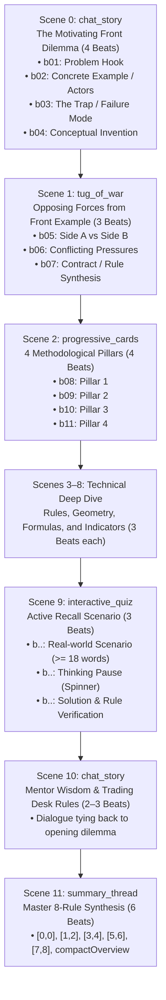

# CANONICAL SCRIPT SOUL — Universal Pedagogical Architecture

This document defines the permanent, inviolable narrative architecture ("the soul of the script") for ALL educational video lessons produced by the engine, across all courses (Hull Derivatives, Murphy Technical Analysis, Coulling VPA, etc.), whether generated via **Gemini 4 Argon**, **Gemini 3.8 Flash**, or **Argon + Flash hybrid**.

---

## The Non-Negotiable Invariant: Problem-First Front Hook

Every chapter across every course MUST begin with a **concrete, relatable real-world dilemma and mini-example upfront**.
Dry textbook definitions (e.g., *"What is technical analysis? It is the study of charts."*) are **STRICTLY PROHIBITED** as quality violations.

The viewer must immediately understand:
1. **What was the real-world friction, trap, or crisis?** (Concrete story with realistic actors, timing, and numbers).
2. **Why did conventional thinking / naive methods fail?**
3. **Why did the author or market invent this specific concept to solve it?**

---

## 12-Scene Universal Structural Template

---

## Scene-by-Scene Specifications

### Scene 0: `chat_story` — The Front Hook & Concrete Mini-Example
- **Template**: `chat_story`
- **Beats**: Exactly 4 beats (`b01`, `b02`, `b03`, `b04`)
- **Visual**: Conversation bubbles progressively displaying dialogue.
- **Beat Roles**:
  - `b01` (Raju / Alex): Asks an eager, practical question about a real-world struggle, market trap, or failure mode.
  - `b02` (Sharma ji / Marcus): Introduces the **Concrete Real-World Situation & Actors** (e.g. 1848 Midwest corn farmers; or an investor buying XYZ stock on glowing quarterly earnings).
  - `b03` (Sharma ji / Marcus): Reveals the **Trap / Failure Mode / Crisis** (e.g. Bumper crop crashes prices; or quarterly reports lag by 3 months while smart money already dumped the stock, causing 30% blindside losses).
  - `b04` (Sharma ji / Marcus): Explains the **Conceptual Invention & Author Solution** (e.g. 1848 CBOT standardized contracts; or Charles Dow & John Murphy proved price action discounts all fundamentals in real time).

### Scene 1: `tug_of_war` — The Conflicting Commercial Forces
- **Template**: `tug_of_war`
- **Beats**: 3 beats (`b05`, `b06`, `b07`)
- **Visual**: Tension bar pitting the two opposing commercial interests against each other.
- **Content**: The two sides directly involved in the Scene 0 opening story (e.g. Corn Farmer downside fear vs Flour Miller upside price ceiling; or Trapped fundamental crowd relying on stale news vs Informed chartist following leading price action).

### Scene 2: `progressive_cards` — The 4 Methodological Pillars
- **Template**: `progressive_cards`
- **Beats**: 4 beats (`b08`, `b09`, `b10`, `b11`)
- **Visual**: 4 structured cards highlighting the chapter roadmap.
- **Content**: The 4 analytical pillars that systematically solve the opening dilemma.

### Scenes 3 to 8: Core Technical Demonstrations
- **Templates**: `split_comparison`, `progressive_cards`, `formula_breakdown`, `stat_counter`, `diagram_flow`, etc.
- **Content**: Grounded strictly in author teachings (`source_facts.json`):
  - Precise chart geometry, angles, and formation rules.
  - Mathematical calculations and percentage thresholds (e.g. 3% filter, 2-day rule, Fibonacci ratios, RSI parameters).
  - Institutional volume and open interest confirmation sequences.
  - Authentic signals versus false breakout whipsaws.

### Scene 9: `interactive_quiz` — Active Recall Scenario
- **Template**: `interactive_quiz`
- **Beats**: Strictly 3 beats
  - Beat 0: Scenario Question containing **at least 18 words** presenting a realistic trading dilemma.
  - Beat 1: Thinking Pause with `showThinkingSpinner: true` (3200ms pause).
  - Beat 2: Answer reveal, explanation, and `correctIndex`.

### Scene 10: `chat_story` — Senior Analyst Wisdom
- **Template**: `chat_story`
- **Beats**: 2–3 beats
- **Content**: Mentor cautionary advice tying directly back to avoiding the opening dilemma through emotional discipline.

### Scene 11: `summary_thread` — Master 8-Rule Synthesis
- **Template**: `summary_thread`
- **Beats**: Strictly 6 beats with exact `activeStepRange` sequence:
  - Beat 0: `[0, 0]` Roadmap Overview
  - Beat 1: `[1, 2]` Rules 1 & 2
  - Beat 2: `[3, 4]` Rules 3 & 4
  - Beat 3: `[5, 6]` Rules 5 & 6
  - Beat 4: `[7, 8]` Rules 7 & 8 (dedicated focus)
  - Beat 5: `[1, 8]` with `compactOverview: true` (2-column whole-chapter grid)

---

## Course Exemplars

| Course | Front Hook Mini-Example | Opening Dilemma / Trap | Conceptual Invention |
| :--- | :--- | :--- | :--- |
| **Hull Derivatives (Ch 1)** | 1848 Midwest corn farmers planting in June for September harvest. | Bumper harvest collapses prices bankrupting farmers; drought causes flour price spikes bankrupting millers. | 1848 CBOT standardized 5,000-bushel forward/futures contracts locking delivery prices in advance. |
| **Murphy Technical Analysis (Ch 1)** | An investor buying stock on record quarterly earnings reports. | Earnings reports lag by 3 months; smart money already dumped on insider knowledge; stock drops 30% blindsiding the investor. | Price action discounts all fundamental information in advance; charts lead news, giving real-time survival. |
| **Coulling Volume Price Analysis (Ch 1)** | A retail trader buying a massive breakout candle on glowing media hype. | Narrow price spread on ultra-high volume reveals smart money distributing to retail at the market top. | Wyckoff VPA reveals the true institutional footprint by pairing candle spread with tick volume. |

